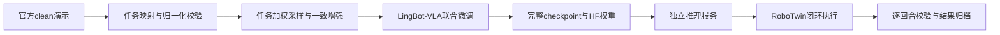

# LingBot-VLA × RoboTwin

**双臂机器人50任务联合微调、可恢复训练与闭环评测，以及RTC实时推理方案。**

基于[官方LingBot-VLA 2.0](https://github.com/Robbyant/lingbot-vla-v2)，在RoboTwin 2.0的Aloha-AgileX平台上使用 **50任务 × 50条clean演示** 联合微调至25,000 steps。项目覆盖数据映射与归一化、分布式续训、任务采样、时序一致增强、推理服务和仿真结果校验。

*Multi-task VLA fine-tuning and reproducible closed-loop evaluation for bimanual manipulation.*

[实验结果](experiments/benchmarks/step22000_step25000/README.md) · [技术设计](docs/design.md) · [RTC推理](docs/rtc.md) · [复现指南](docs/reproduction.md) · [个人贡献](contributions/README.md)

## 项目看点

| 问题 | 本项目的实现 | 代码 / 证据 |
| --- | --- | --- |
| 语言指令ID不等于机器人任务ID，按帧采样也会偏向长任务 | 审核2500条episode到50个任务的映射；先抽任务、再均匀抽帧，10个弱任务权重1.5 | [映射校验](tools/continuation_15000/task_mapping.py)、[可恢复采样器](tools/continuation_15000/stage_data.py) |
| 续训容易只恢复权重，遗漏优化器、数据游标或学习率状态 | 校验完整checkpoint、各rank训练状态、采样器及RNG；核验实际LR与调度边界 | [恢复钩子](tools/continuation_15000/training_hooks.py)、[启动门槛](tools/eval_after_training/gates.py) |
| 增强可能破坏当前帧、未来帧和辅助监督的一致性 | 10%原图、90%随机组合增强；同一draw复用参数，策略与深度/视频教师使用相同增强RGB | [增强实现与测试](tools/continuation_17000/) |
| 相同seed不一定重建相同仿真场景 | 定位杂物采样边界的可变默认参数累积问题；冻结专家有效场景，恢复物体及机器人初始状态 | [仿真修复](RoboTwin/envs/_base_task.py)、[状态重放](tools/eval_after_training/scene_repair.py) |
| 动作块之间的推理等待造成停顿和轨迹不连续 | 推理侧采用RTC异步续接与重叠动作引导；区分预测、执行和去噪迭代长度 | [RTC方法与接入说明](docs/rtc.md) |

## 已验证的结果

每种setting为 **50任务 × 每任务50回合 = 2500回合**。训练只使用官方clean数据；randomized仅用于评测。

| Checkpoint | clean + seen | randomized + unseen | 结果范围 |
| --- | ---: | ---: | --- |
| step22000 | **79.40%（1985/2500）** | **43.96%（1099/2500）** | clean为50任务；randomized为48任务，每任务50回合 |
| step25000 | 77.64%（1941/2500） | **43.52%（1088/2500）** | 两项受场景问题影响的任务已修复重测 |

step25000两设置等权平均为 **60.58%**。表中是 **FP32、固定执行50步、10次Flow Matching迭代、关闭录像** 的本地仿真结果，**不含RTC收益**。在双方相同的48个randomized任务上，22k为1055/2400，25k为1059/2400；不同任务范围的总分不直接作为两权重的完整比较。

结果可查看[逐任务CSV](experiments/benchmarks/step22000_step25000/per_task.csv)、[机器可读摘要](experiments/benchmarks/step22000_step25000/summary.json)与[来源哈希](experiments/benchmarks/step22000_step25000/provenance.json)。早期每任务10回合的实验单独保存在[历史对比](experiments/comparisons/step5000_vs_step10000/README.md)，不与50回合结果混算。

## 从数据到闭环执行



训练使用FP32、Distributed Muon和梯度检查点；global batch保持160。后续阶段使用2张A100 80GB，每卡micro batch 20、累积4次，从完整状态续训。15k→25k阶段的LR先在200步内升至`7.5e-5`，再余弦下降至`2.5e-5`；17k起启用10/90增强配方。

显存优化通过短测做选择：4卡、micro batch 20、累积2次时，关闭梯度检查点的平均step时间仅从11.421s降到11.402s，峰值显存却从约50.19GiB升到79.19GiB，因此正式训练保留检查点。后续2卡阶段实测20.44s/step；两者的GPU数量与增强配置不同，不作为同条件提速对比。详见[训练与工程取舍](docs/design.md)。

## RTC推理方案

一次预测50个动作，不代表必须执行完50个动作才重新观察，也不代表做50次Flow Matching：

| 参数 | 本项目基线值 | 含义 |
| --- | ---: | --- |
| `chunk_size` / `n_action_steps` | 50 | 一次预测的动作序列长度 |
| `use_length` | 50 | 固定块基线交给机器人执行的长度 |
| `num_steps` | 10 | 生成整个动作块的Flow Matching迭代次数 |

RTC在执行旧动作时异步预测新块，并用旧块尚未执行的动作引导生成，维持衔接连续性。例如执行到第20步开始推理，继续执行旧块的第20–29步，在第30步接到新块中对应时刻的动作。

项目采用的RTC思路来自Physical Intelligence的[Real-Time Execution of Action Chunking Flow Policies（2025-06-09）](https://arxiv.org/abs/2506.07339)。[技术说明](docs/rtc.md)记录时间对齐、软掩码、动作张量梯度和LingBot时间方向的映射。本次公开快照包含RTC方案说明；RTC专用运行代码和延迟/平滑度对照结果未随本次快照发布。

## 快速查看与复现

不需要GPU或模型权重，即可检查结果归档与汇总逻辑：

```bash
git clone https://github.com/Arborsen/LingBot.git
cd LingBot
python -m unittest discover -s tools/tests -v
python -m unittest discover -s tools/eval_after_training -p 'test_gates.py' -v
python -m unittest discover -s tools/eval_after_training -p 'test_campaign_aggregation.py' -v
```

完整训练和仿真需要另行准备官方权重、clean演示、RoboTwin资产和两套Python/CUDA环境。安装入口、归一化校验、训练接入点及可执行检查见[复现指南](docs/reproduction.md)。公开仓库保存源码、配置与小型结果摘要；大型权重、数据、原始录像、日志和机器凭据留在本地。

## 目录与阅读顺序

```text
docs/design.md                  # 训练、恢复、显存与评测设计
docs/rtc.md                     # RTC原理、时间轴、接口映射
tools/continuation_15000/        # 任务采样、学习率、恢复和配对工具
tools/continuation_17000/        # 时序一致的10/90图像增强
tools/eval_after_training/      # 场景修复、状态重放、严格汇总及测试
experiments/benchmarks/         # 50回合评测摘要、逐任务统计、来源哈希
lingbot-vla-v2/                 # LingBot-VLA源码快照及本地适配
RoboTwin/                       # RoboTwin源码快照及仿真修复
```

模型架构与仿真平台来自上游项目；个人实现范围、源码关系与实验限制见[贡献清单](contributions/README.md)。本仓库新增工具和文档采用[MIT许可证](LICENSE)，第三方源码继续按各自许可证分发，见[THIRD_PARTY_NOTICES](THIRD_PARTY_NOTICES.md)。
